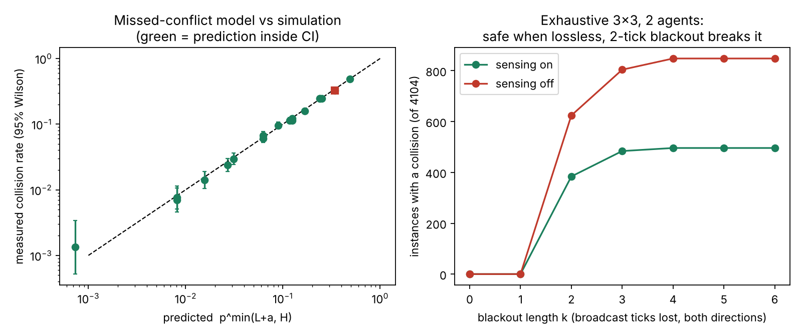
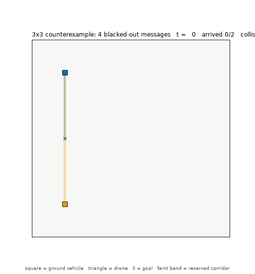

# stc-formal


Formal-methods companion to [`stc-corridors`](https://github.com/olamida/stc-corridors): **how safe is the
decentralized corridor protocol, exactly, and where does it break?** Simulation
only, no hardware, fully reproducible.

`stc-corridors` showed *that* the protocol works under lossy comms. This project
asks *why*, *by how much*, and *what is the smallest failure that breaks it*.



## What is in here

| Piece | File | What it does |
|---|---|---|
| Runtime monitor | `src/stcformal/monitor.py` | Small STL-style fragment (`Always`, `Eventually`, quantitative robustness) evaluated on recorded traces; independent re-derivation of the simulator's collision count (vertex + swap). |
| Loss model | `src/stcformal/loss_model.py` | Closed-form missed-conflict estimate `p^min(L+a, H)` compared with Monte Carlo. |
| Counterexample search | `src/stcformal/search.py` | Exhaustive enumeration of all 4104 two-agent 3x3 instances under scripted (deterministic) message blackouts. |
| Planner oracle | `src/stcformal/planner_check.py` | Time-expanded BFS used to test that the space-time A* returns the earliest arrival. |
| Tests | `tests/test_formal.py` | 65 tests (incl. 60 randomized planner-vs-BFS cases). |

## Results (all numbers from `results/*.csv`)

**1. Lossless safety, exhaustively.** For all 4104 two-agent 3x3 instances, with
and without adjacent-cell sensing, the protocol completes with 0 collisions.
(Two agents, 3x3, lossless only; this is a finite check, not a general proof.)

**2. How little loss breaks it.** Scripted blackouts of the *first k broadcast
ticks*: k = 1 is always safe; **k = 2 already causes collisions** (384/4104
instances with sensing, 624/4104 without, both directions blacked out). Only
the direction high-priority -> low-priority matters: blacking out the reverse
direction caused 0 collisions. Sensing helps but cannot fix everything: a
representative failure is two agents entering the same *free* cell in the same tick (sensing only
sees cells that are already occupied).

**3. A one-line model of the loss curve.** Two agents crossing on an open grid,
sensing off, 3000 runs per cell. Missed-conflict probability follows
`p ** min(L + a, H)`: the number of broadcasts that carry the conflict is capped by the horizon `H`, and
`a = 1` with announce-then-act (the forced first wait delays the conflict one tick).
Honest history: my first model had `a = 0` and was off by exactly one factor of `p`;
I corrected it after seeing the data, so those 15 points are *in-sample*. The
correction was then tested out of sample by turning announce-then-act off (prediction `a = 0`):
**3 of 4 new points fall inside the 95% Wilson interval**, the fourth (L=5, H=3, p=0.7:
measured 0.324 vs predicted 0.343) is marginally outside. Overall 18 of 19 points are inside.
This is a model of *one* geometry, not a general theorem.

## Limitations
* Two-agent instances only for the exhaustive search; the loss model is for one crossing geometry.
* Blackouts are indexed by message-draw count, which equals ticks only while both agents are active.
* The STL fragment is deliberately tiny (no nesting, no until); it is a monitor, not a model checker.

## Reproduce
```bash
pip install numpy matplotlib pytest
# needs ../stc-corridors next to this folder (or `pip install -e` it)
PYTHONPATH=src python -m pytest -q tests          # 65 passed
python experiments/run_formal.py 3000              # ~30 s, writes results/*.csv
python experiments/make_figures.py
```
MIT licensed.


## Simulated animation

[](figures/demo_counterexample.gif)

*Smallest two-agent 3x3 counterexample. Regenerate with `python experiments/make_animation.py`; the frames are produced by this project's own simulator.*


## How this connects

Formal companion to [`stc-corridors`](https://github.com/olamida/stc-corridors); complements the verification work in [`rtos-sched-lab`](https://github.com/olamida/rtos-sched-lab).

## Portfolio documentation

- [`APP-GUIDE.md`](APP-GUIDE.md) — work executed and work still to do.
- [`USER-GUIDE.md`](USER-GUIDE.md) — end-user manual.
- [`PENDING-TASKS.md`](PENDING-TASKS.md) — AI session-continuity ledger.
- [`SYSTEM-DOCUMENTATION.md`](SYSTEM-DOCUMENTATION.md) — developer/architecture reference.
